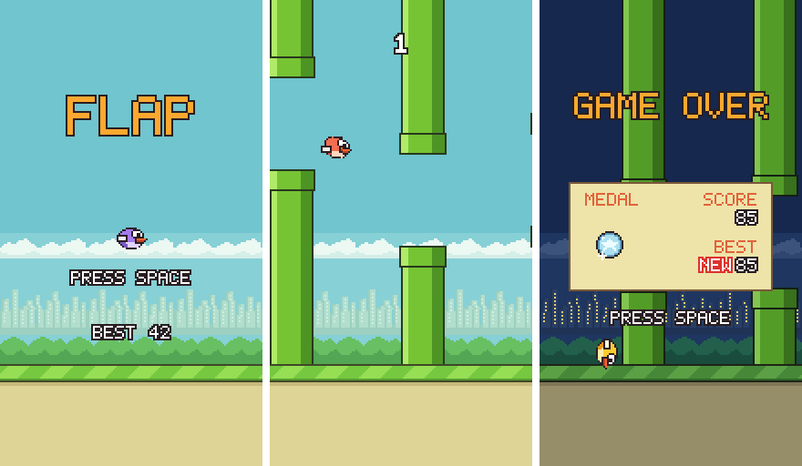

# flappy-a64

Flappy Bird's gameplay, written in AArch64 assembly and played in a terminal. The physics, the
layout, the timing and the flow follow the original game. The art is mine. I drew the bird,
the pipes, the city, the font and the medals for this.



It draws with half blocks and 24-bit colour at up to 60 frames a second. Each terminal cell
holds two pixels, and each frame sends only the cells that changed since the one before.

## Run it

On Windows, inside WSL (Ubuntu or Debian):

```
sudo apt install make m4 gcc-aarch64-linux-gnu libc6-dev-arm64-cross qemu-user
git clone https://github.com/Abdalla-Eldoumani/flappy-a64
cd flappy-a64
make play
```

`make play` builds a static aarch64 binary and runs it with `qemu-aarch64`. On an aarch64
Linux machine the same `make play` builds with the native `gcc` and runs the program directly.

The release carries the static binary, `flappy-linux-arm64`. An aarch64 Linux machine runs it
as it is. Anywhere else, run it as `qemu-aarch64 ./flappy-linux-arm64`.

## Controls

| Key | Does |
|---|---|
| Space, W, K, up arrow, Enter, left click | flap, start, play again |
| P | pause |
| D | debug numbers: frames a second, bytes per frame, scale |
| Q, Esc, Ctrl-C | quit |

The game keeps the best score in `.flappy_best`, in the folder it runs from. For `make play`
that is `build/`.

## Terminal size

The game is 144 by 256 pixels. At full size, s = 1, it needs a terminal 144 columns wide and
128 rows tall. A smaller window gets a smaller picture: s = 2 needs 72 by 64, s = 3 48 by 43,
and s = 4 36 by 32. Below that, the game shows the size it has and the size it needs, and
waits. At any s above 1 the title says ZOOM OUT, except at s = 3 in the lite profile, which
never draws larger (below).

In Windows Terminal:

- Ctrl and minus makes the font one point smaller, Ctrl and plus one point bigger, and Ctrl
  and 0 puts it back.
- F11, or Alt and Enter, switches full screen on and off.
- A maximised window on a 1080p screen at 100% display scaling reaches s = 1 with a font of
  about 4 to 5 points. That is my estimate, not a measurement.

## How it works

**The frame.** Every tick the game draws the whole scene into a byte buffer, one palette index
per pixel, at the scale the terminal allows. Shrinking keeps the most important colour in each
block, outlines first, so edges survive. The bird has its own small drawing for each smaller
size, and the words use a smaller pixel font.

**Half blocks.** A terminal cell shows two pixels, one above the other. When both match, the
cell is a space in that background colour or a full block in that foreground colour. Two
different pixels become an upper or a lower half block, whichever keeps the colours the
terminal already has set.

**The diff.** The presenter keeps the last frame and compares the new one eight cells at a
time, and it writes only the cells that changed. Where one to three unchanged cells sit in the
current background colour, writing them as spaces is shorter than moving the cursor, so it
does that. Synchronized output wraps each frame, so a terminal that supports it never shows
half of one. A frame where nothing changed writes nothing.

**Pacing.** Ticks run at exactly 60 a second from the monotonic clock. Two periods of
16,666,667 ns and one of 16,666,666 make 50 ms for every three ticks. A game that falls behind
runs up to five ticks to catch up and drops the rest.

Numbers from the autopilot, seed 7, 3,600 ticks, with more in
[docs/PERFORMANCE.md](docs/PERFORMANCE.md):

- At s = 1 the game writes 16.6 KB per frame on average. Three quarters of that is colour codes.
- A frame takes 24 microseconds on a native aarch64 Linux server.

The program calls no library functions, has no heap, keeps every section under 1 MiB, and
uses twelve system calls, all of which the AArch64 Playground has. A thirteenth,
rt_sigaction, runs only for `--lite` outside the playground (below).

## In the AArch64 Playground

`make bundle` writes the whole program as one file, `dist/flappy-bundle.asm`, which the
AArch64 Playground loads and runs in its terminal pane. With nothing typed, the game takes a
lite profile there. It tells the playground from a real terminal by the control characters the
terminal reports: the playground reports none at all, and a real terminal has Ctrl-C, Ctrl-D
and the others set.

The lite profile changes only what goes to the terminal. The game still runs 60 ticks a
second.

- It draws a frame every second tick.
- The game's 64 colour slots are palette indexes 16 to 79, set once with OSC 4. Day and night,
  the bird's colours, the fades and the flash change the palette with a short OSC 4 update,
  and no cell is sent again.
- OSC 104 gives the terminal its own palette back when the game ends with q, Esc or Ctrl-C,
  and when the too-small notice replaces the picture. When the picture returns, the game's
  palette goes out again first.
- The picture is never larger than s = 3. In the playground, s = 2 and s = 1 need more steps a
  second than its refill of 1,000,000 and were stopped after 17.2 and 4.8 seconds, so a bigger
  pane shows the s = 3 picture in its middle. The title says ZOOM OUT only at s = 4, the one
  scale where zooming out still makes the picture bigger.

The reason is the playground's output budget. A program there starts with 4 MiB of output and
earns back 100,000 bytes for each second it sleeps, up to another 4 MiB in all. In 24-bit
colour at s = 3 the game wrote 118,315 bytes a second, and the playground stopped it after
68.9 seconds. At 48x43 the lite profile writes about 72,800 bytes a second, and no second goes
over 89,494; at 144x128, with the same s = 3 picture in the middle, about 73,300 and 90,122.
Both stay under the refill. [docs/PERFORMANCE.md](docs/PERFORMANCE.md) has the measurements.

In today's playground:

- The game still stops after 102 seconds. A sleep's refund counts against the 4 MiB cap on
  refunds even when the budget is already full and gains nothing from it, so the refunds are
  used up after about 42 seconds, and the starting 4 MiB about a minute later.
- The playground does not report the pane's size, so with nothing typed the game guesses
  80x24, which fits no scale, and shows the too-small notice. Type a size no larger than the
  pane as the program's arguments, such as `--size 48x43` for s = 3; the game keeps that
  size. A playground that reports the size needs nothing typed: the game uses it and follows
  every resize.
- When the playground stops the game itself, with its stop button or one of its limits, nothing
  sends OSC 104, and the pane keeps the game's colours in indexes 16 to 79.

`--lite` turns the same profile on in any terminal. The terminal has to understand OSC 4 and
OSC 104, or the colours come out wrong. On the way out, OSC 104 sets every palette index back
to the terminal's default, colours you set yourself included. Outside the playground, `--lite`
also catches SIGTERM, so a kill gives the terminal and its palette back as q does.

## Build and test

- `make` builds `build/flappy`. `make bundle` writes the whole program as one file,
  `dist/flappy-bundle.asm`.
- `make test` runs the checks below. It needs python3, and Node.js 24 for the terminal
  replays. The Makefile installs `@xterm/headless` with `npm ci`.
  - goldens: headless runs print the game state every 60 ticks, and ten recorded runs must
    match byte for byte, from the normal build and from the one-file bundle.
  - physics: an independent Python model of the game must print the same lines.
  - encoder: a headless terminal replays what the presenter wrote, and every cell must match
    the frame it should show: in 24-bit colour at s = 1 and s = 3, and in the lite profile's
    palette indexes at s = 3 and s = 4, through fades, a death and a medal.
  - smoke: the game plays on a pseudo-terminal with every flap key, pause, a resize, a window
    too small, quit, Ctrl-C and a kill. With `--lite`, q, Esc, Ctrl-C, the too-small notice
    and SIGTERM must each give the palette back with OSC 104. A terminal with no control
    characters, like the playground's, must get the lite profile at the size it reports, no
    larger than s = 3, and follow a resize; a normal one must get 24-bit colour, a frame every
    tick and s = 1 at 144x128, unless `--lite` is given.
  - best: the best score file is written, read back, and ignored when it is not a number.
  - harden: a slow terminal, a stalled one, one that closes, a closed pipe, no terminal at all,
    sizes far too small and too large, a best score file that cannot be written, and a
    folder for frame dumps too long for the file path. The stalled and the closed terminal
    run again in the lite profile, where the frame after a cut sends the whole palette first.
- `make frames` renders named moments to PNGs and a contact sheet. It needs netpbm.
- `make soak` plays on the autopilot for ten minutes. `make envelope` measures what a session
  costs in the playground.
- `make playground`, part of `make test`, and `make envelope` run the bundle in the AArch64
  Playground's emulator. `make playground` checks the ten recorded runs there, and that with
  nothing typed the game takes the lite profile, draws no larger than s = 3, and quits on q
  without a system call the playground lacks. That emulator is not in this repository: copy
  its wasm-node build to `build/playground-wasm`, or the two targets print that they were
  skipped.
- `./flappy --headless --ticks N --seed S` prints the game state without a terminal,
  `--autopilot` plays by itself, `--bench` prints the cost of every frame, `--size COLSxROWS`
  fixes the size the game draws for, and `--lite` turns on the lite profile, which draws no
  larger than s = 3.

## Credits

The gameplay is Dong Nguyen's Flappy Bird. The physics start from the classic constants of
FlapPyBird, which is MIT licensed. I made everything in this repository for it, the art and
the font included.

## License

MIT. See [LICENSE](LICENSE).
